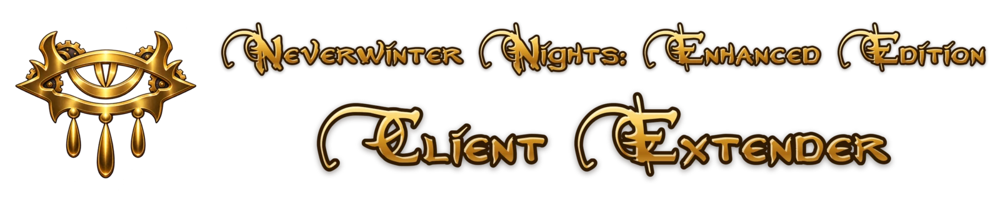

# NWNCX:EE (CX)

This is the _Neverwinter Nights: Enhanced Edition Client Extender_, a free and open-source add-on for the NWN:EE client that gives the game a modern renderer, a proper chatbox, shinier nameplates, and true 3D sound. It only changes your client, so it works on any server you already play on.

There's more to see in the [gallery](media/README.md).

**[Download the latest release](https://github.com/nwncxee/cx/releases/latest)** for Windows or Linux.

## Features

**Graphics.** NWNCX:EE draws the 3D world with its own Vulkan renderer, which we call Alloy. There are many modern improvements that increase visual fidelity while also helping performance too. Real-time shadows, adaptive fog colouring, HDR with exposure, tone mapping, and bloom. Denser grass and precipitation that actually covers surfaces, improved wind physics, and GPU texture streaming. Alloy needs a Vulkan 1.3 driver; on a machine without one it stands down and the game draws the world the way it always did, with every other feature still running.

**Animation.** Animation transitions are much less stiff but the animations themselves remain mostly unchanged. Each movement eases into the next and uses simulated inertia; stride length changes with creature speed, so sliding is a thing of the past. Feet actually adjust to the floor so you _walk_ up and down stairs instead of floating over them.

**Chat.** We've also replaced the stock chat window with something more suited to modern games, all fully customizable. You can split it into multiple windows with tabs, portraits, timestamps, and adjustable colours. Click-and-drag, copy-and-paste, highlightable text, and many more usability improvements you'd expect from a modern GUI.

**Interface.** Crisper floating names, speech bubbles, damage numbers, and combat banners. You can choose between a nested dropdown menu or the radial menu. Our own windows can be resized, scrolled, and moved anywhere on the screen, and many NUI improvements have been added like faster refreshes and scrollbars that don't break with long lists. An all new replacement for the quickbar is adjustable and accepts real keybinds.

**Sound.** Real 3D positional sound with Steam Audio using HRTF. Reverb is traced from an area's own geometry; a cave will actually echo like a real cave, and walls muffle sound that comes from behind them. Loud soundscapes are much less annoying and grating, and music and ambience crossfade.

**Camera.** Improved camera smoothing, field of view and auto-recenter. You can set up the chase or driving camera to play like true 3rd person. There's also a new Action Camera inspired by several popular MMO franchises, and a Free Camera mode.

There's a lot of other stuff you can also turn on: better inventory with search, MMO-style tab-targeting, and more to come. Everything is accessible in the settings panel by typing `/settings` in chat, or by clicking the gear in the lower-left corner of the main menu.

## Safe to try

You don't have to use the Client Extender if you don't want to. Uninstallation is as easy as deleting the files.

GitHub builds every release from its tagged source. We sign the checksums, so you can check for authenticity. See [Checking a download is genuine](#checking-a-download-is-genuine). Only install a build from our releases page or one you built yourself.

NWNCX:EE is not affiliated with or endorsed by Beamdog.

## Install

Download the zip for your system from the
[releases page](https://github.com/nwncxee/cx/releases).

### Windows

1. Unpack `cx-windows-x64-<version>.zip` into the folder that holds `nwmain.exe`:
   - Steam: `<Steam>\steamapps\common\Neverwinter Nights\bin\win32\`
   - GOG: `<GOG Games>\Neverwinter Nights Enhanced Edition\bin\win32\`
2. Start the game as usual. No launch options needed.

To uninstall, delete `version.dll`, `cx_openal.dll`, `phonon.dll`, `shaderc_shared.dll` and `vma.dll` from
`bin\win32\`.

Windows Defender sometimes quarantines `version.dll`. That's a false positive, so add it to Defender's exclusions.

### Linux

1. Find the game folder (Steam: right-click _Neverwinter Nights_ -> Manage -> Browse local files)
   and open `bin/linux-x86/`, the folder that holds `nwmain-linux`.
2. Unpack `cx-linux-x64-<version>.zip` there.
3. Steam: right-click _Neverwinter Nights_ -> Properties -> General -> Launch Options, and paste
   exactly:

   ```
   ./cx-launch %command%
   ```

   Not on Steam: run `./cx-launch` from `bin/linux-x86/`.

To uninstall, clear the launch option.

### macOS

Not supported yet.

### Did it work?

A line of credits appears in the top-left corner of the main menu.

### Checking a download is genuine

Only download CX from the releases page above. Each release has `SHA256SUMS` and
`SHA256SUMS.sig`, a signature made with the maintainer's key. A copy of CX from anywhere else can
match its own checksums, but it can't have that signature.

A first install trusts the releases page it came from, and every later download is checked against the
key your install shows. For a first install, the key is [`packaging/allowed_signers`](packaging/allowed_signers).

When you upgrade, take the key from the CX you already run. Open General » About and press
*Copy release key*. The lines under it are the key's fingerprints. Save the copied text as
`allowed_signers`:

- Linux: paste it into a new file named `allowed_signers`.
- Windows, in PowerShell: `Get-Clipboard | Set-Content -Encoding ascii allowed_signers`. Don't use
  `Get-Clipboard > allowed_signers`: Windows PowerShell 5.1 writes that file as UTF-16, and ssh-keygen
  can't read it.

With the zip, `SHA256SUMS`, `SHA256SUMS.sig` and `allowed_signers` in one folder:

```sh
ssh-keygen -Y verify -f allowed_signers -I cx-releases -n file -s SHA256SUMS.sig < SHA256SUMS
sha256sum -c --ignore-missing SHA256SUMS
```

The first line must print `Good "file" signature for cx-releases`, and the second must print `OK` for
your zip. The fingerprint the first line prints after `with ED25519 key` must be one of those under
*Copy release key*.

On Windows, OpenSSH ships with Windows 10 and 11. PowerShell can't run the first line as written, so run
it through `cmd` in PowerShell:

```powershell
cmd /c "ssh-keygen -Y verify -f allowed_signers -I cx-releases -n file -s SHA256SUMS.sig < SHA256SUMS"
```

Then compare the output of `Get-FileHash cx-windows-x64-<version>.zip` with the zip's line in `SHA256SUMS`.

Releases after v0.9.1 also have a build attestation, which proves this repository's release workflow
built the zip on GitHub from the tag. With the [GitHub CLI](https://cli.github.com/) installed:

```sh
gh attestation verify cx-linux-x64-<version>.zip -R nwncxee/cx \
  --signer-workflow nwncxee/cx/.github/workflows/release.yml --source-ref refs/tags/<version>
```

It must print `Verification succeeded!`.

In releases after v0.12.0, the Windows zip is the exception. The maintainer adds a Windows code signature
to its `version.dll` after GitHub builds it, so its attestation no longer matches, and `SHA256SUMS.sig`
covers it instead. To check the code signature, right-click `version.dll`, open Properties, then Digital
Signatures: the signer must be `Open Source Developer Michał Piasecki`, and the issuer Certum. In
PowerShell, `Get-AuthenticodeSignature version.dll` must print `Valid`. Someone with the same name can
buy a matching certificate, so on an upgrade the signed `SHA256SUMS` is the stronger check.

## Reporting a problem

CX writes `cx.log` every time the game runs. Play until the problem happens again, then open an [issue](https://github.com/nwncxee/cx/issues) with `cx.log` and `cx.1.log` from the game's `logs` folder (next to `nwn.ini`, or wherever `[Alias]` in `nwn.ini` moves `LOGS`) and what you were doing right before things went wrong. If you restarted the game after the problem, it is in `cx.1.log`.

## Build from source

On Linux with Nix, `./build.sh` enters the pinned toolchain from `flake.nix` by itself, the same one CI uses:

```sh
git clone --recursive https://github.com/nwncxee/cx.git
cd cx
./build.sh       # -> cx-linux-x64/ and its zip
./run-demo.sh    # boots the framework without the game
```

Without Nix, install the .NET 10 SDK, clang 21, gcc 15, ld.lld, zlib, cmake, pkg-config and the
PipeWire, PulseAudio and ALSA headers yourself. `flake.nix` has the full list.

The Windows build is cross-compiled on Linux with `nix develop .#win -c ./build-win.sh`. That shell
downloads the Windows SDK and MSVC libraries from Microsoft, and building it accepts Microsoft's licence. [`ARCHITECTURE.md`](ARCHITECTURE.md) covers the
architecture and how to add a feature, and [`BUILDING.md`](BUILDING.md) the build in full.

## Contributing

Talk to us before you build a feature, on a GitHub issue or on the CX Discord. [`CONTRIBUTING.md`](CONTRIBUTING.md)
says what a pull request needs, from that agreement to its proof and its performance numbers.

## Contact

Michał Piasecki: mpiasecki720@protonmail.com

## License

MIT; see `LICENSE`. Third-party notices ship in each release as `LICENSES.txt`.
