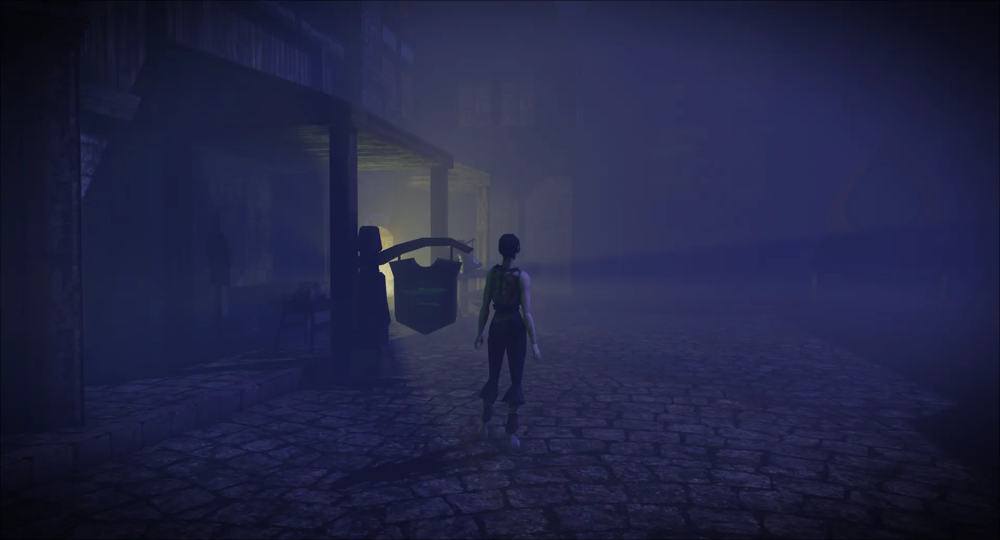
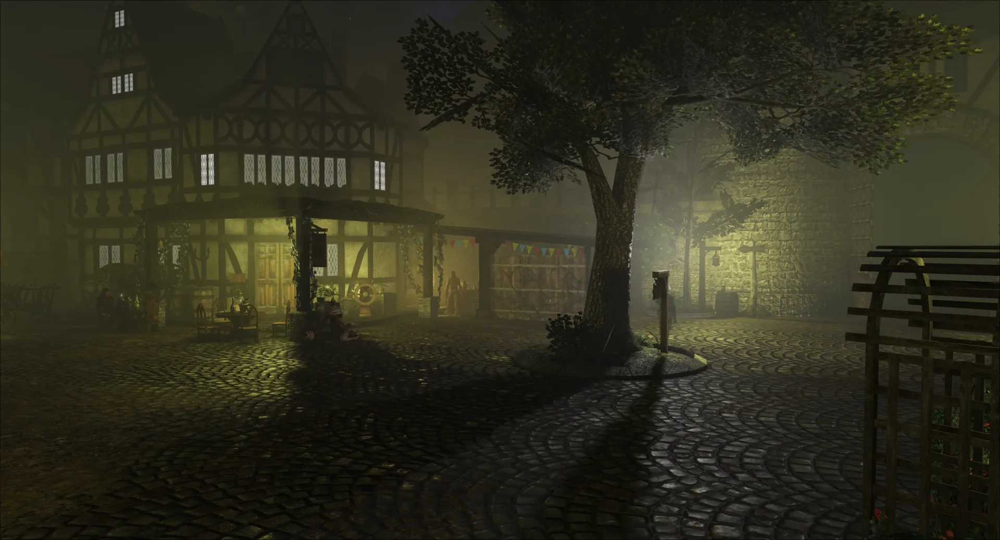
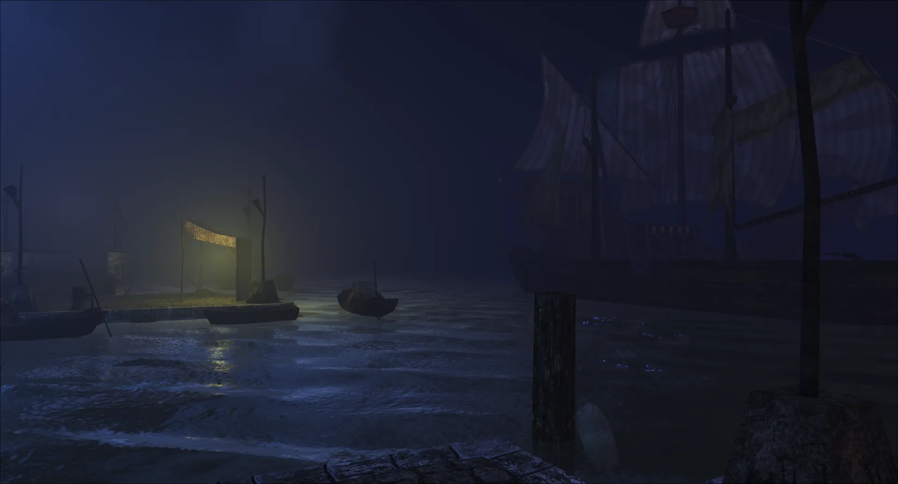
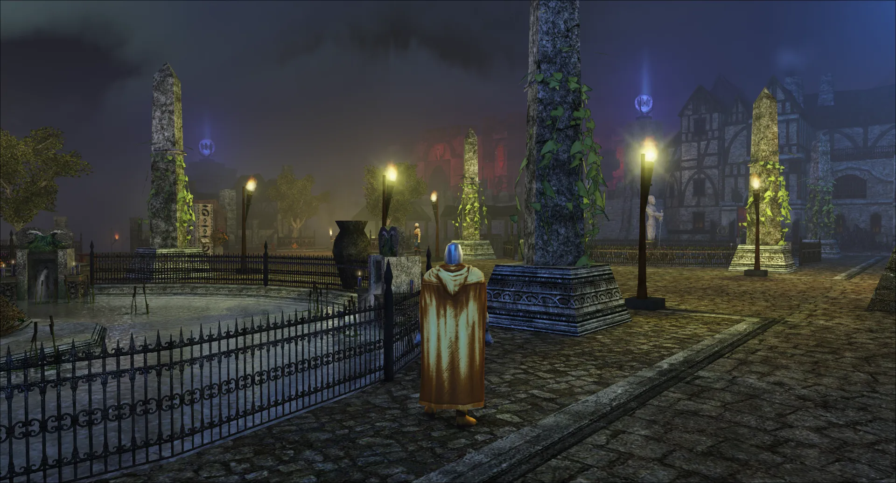
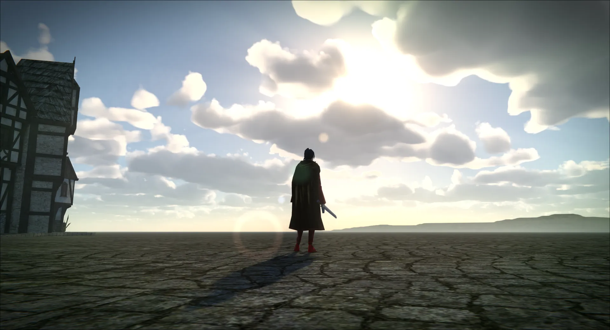
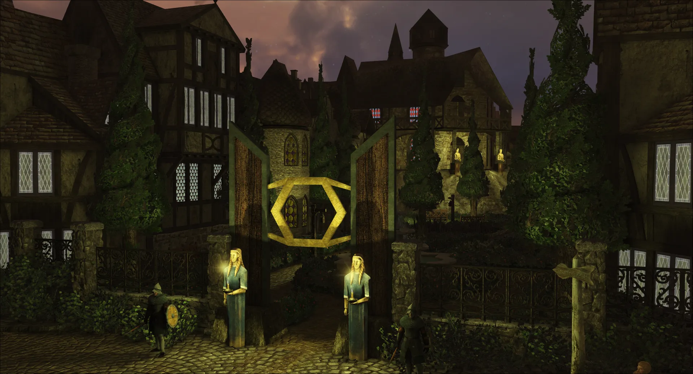
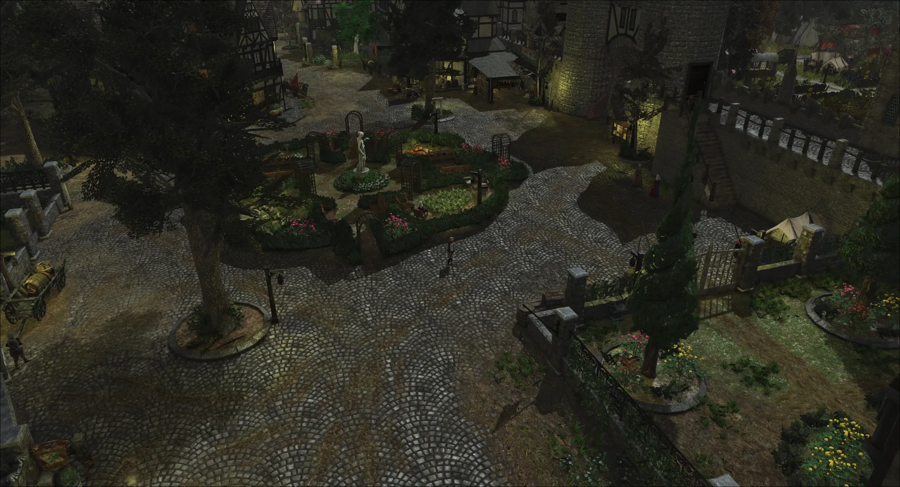

# Gallery

Screenshots and clips of CX in the game. Every file here must be under 300 KB. Compress a screenshot to
WebP and a clip to WebM before you add it.

## Rain in a town square

## A street in fog

## A lamplit courtyard

## A harbour at night

## An obelisk plaza

## Sun through clouds

## A temple gate at dusk

## Gardens from above

