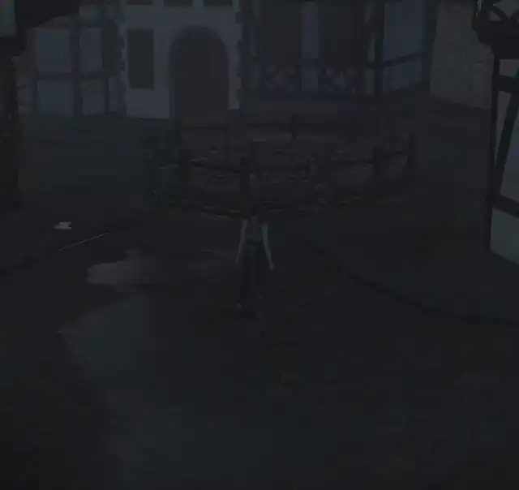

# Gallery

Screenshots and clips of CX in the game. Every file here must be under 300 KB. Compress a screenshot to
WebP and a clip to animated WebP before you add it, because GitHub won't play a video file inside a page.

## Rain in a town square

Rain wets the cobblestones and pools into puddles.

[Full frame rate (WebM)](rain-town-square.webm)
